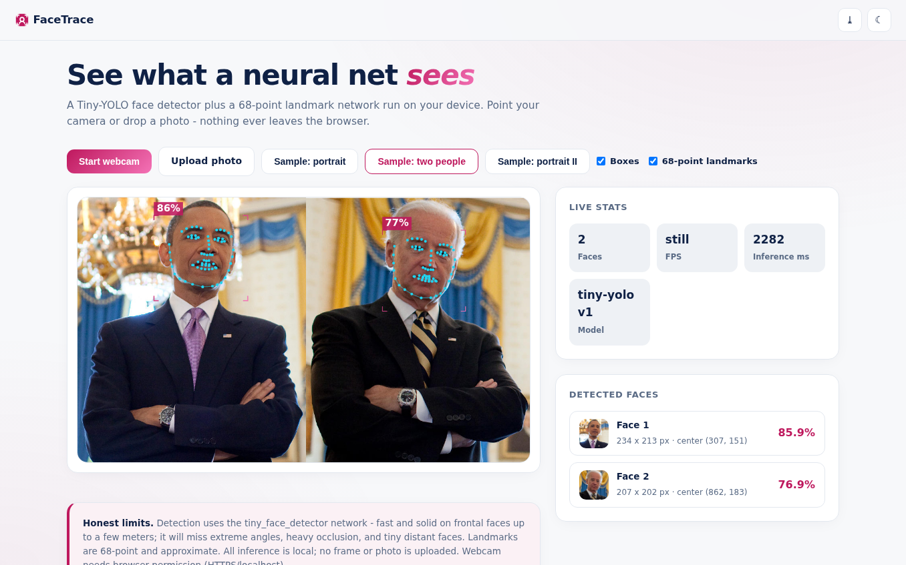
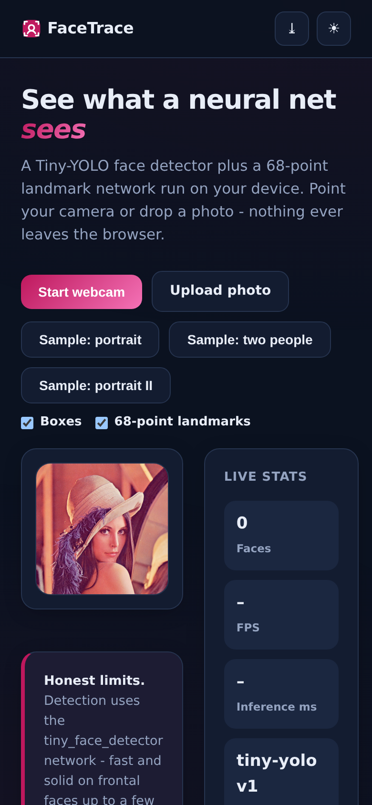

# FaceTrace - Face Detection Lab

A **Tiny-YOLO neural face detector plus 68-point landmark network** running entirely in your browser. Webcam, photo uploads, zero server uploads.

**Live demo:** https://akash991833.github.io/face-detection/

## Features

- **Real neural networks, fully local** - face-api.js tiny_face_detector + face_landmark_68, vendored weights, inference on your device (GPU when available)
- **Live webcam mode** - FPS and inference-ms stats, ~10 detections/sec loop
- **Photo analysis** - upload any image, or use the bundled sample portraits
- **Detection cards** - every face gets a cropped thumbnail, pixel dimensions, center coordinates, and confidence score
- **Visual overlays** - gradient corner brackets, confidence labels, 68 cyan landmark dots with jawline - each toggleable
- **PWA** - installable; models cache for offline use after first load
- **Premium UI** - white professional design, navy ink, pink accent, dark + light themes, responsive desktop and mobile

## Screenshots

## Honest limits

tiny_face_detector is fast and solid on frontal faces up to a few meters; it misses extreme angles, heavy occlusion, and tiny distant faces. Landmarks are approximate. All inference is local - no frame or photo is uploaded. Webcam needs browser permission (HTTPS/localhost). Stated in-app.

## Tech

Vanilla HTML/CSS/JS + face-api.js 0.22.2 (vendored). Sample photos: OpenCV samples, ageitgey/face_recognition examples.

## Run locally

Serve the folder (`python3 -m http.server`) and open `http://localhost:8000` (camera needs localhost or HTTPS).
